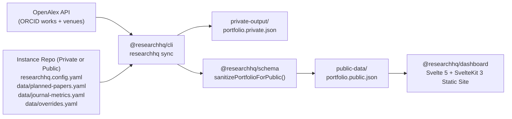

# ResearchHQ

**Open-source interactive research portfolio, hybrid journal metrics explorer, and future-publications roadmap for academics and research groups.**

[](LICENSE)
[](https://www.typescriptlang.org/)
[](https://svelte.dev/)

- **Live Reference Instance (Robin Lovelace):** <https://robinlovelace.net/research/>
- **Framework Demo & Template:** <https://robinlovelace.net/researchhq/>

---

## Why ResearchHQ?

Academic profiles on Google Scholar, ORCID, and institutional CRIS portals only look backward and reduce scholarship to raw citation counts. At the same time, active researchers maintain scattered notes on upcoming manuscripts, target journals, open-access policies, and software tools.

**ResearchHQ** unifies both horizons in a fast, static, privacy-aware dashboard that any researcher can scaffold from their ORCID in under a minute:

1. **Dual-Provenance Citation & Impact Overview:** Automated OpenAlex synchronisation (`worksCount`, `citedByCount`, `hIndex`, `i10Index`, `twoYearMeanCitedness`, annual citation trajectories) paired optionally with Google Scholar snapshots so coverage differences are transparent rather than hidden.
2. **The 5 Stages of Open Science Ladder:** Tracks whether each past and planned output reaches Open Access text (Stage 1), Open or Synthetic Data (Stage 2), Open Source Code (Stage 3), a Reproducible Literate Paper (Stage 4), or a Deployed Interactive Decision-Support Tool (Stage 5).
3. **Hybrid Journal & Venue Metrics:** Combines live OpenAlex venue indicators (2-year mean citedness, journal h-index, DOAJ/OA status, APCs) with optional user-curated Clarivate Journal Impact Factor (JIF) and SCImago Journal Rank (SJR) quartiles, clearly badging metric provenance (`hybrid`, `openalex`, or `curated`).
4. **Past-to-Future Time Series:** Connects historical annual publication output and citations seamlessly into projected submissions and target publication years.
5. **Future Publications Pipeline & Idea Composer:** Manages planned papers across flagship projects, conceptual/methodological contributions, and literature gaps, with ranked target journals, readiness scores, and one-click CLI or interactive YAML/command generation when a new paper idea starts.
6. **Public Framework + Private Data Repo Split:** Keep private working notes (`privateNotes`) and internal repository links in a private data repository while automatically exporting a schema-validated, sanitized `portfolio.public.json` for your public dashboard.

---

## Architecture



### Monorepo Packages

| Package | Path | Description |
| --- | --- | --- |
| `@researchhq/schema` | [`packages/schema`](packages/schema) | Zod v4 schemas, TypeScript types, h-index / i10-index / FWCI / Open Science upgrade analytics, BibTeX formatting, and the public-export sanitizer (`sanitizePortfolioForPublic`). |
| `@researchhq/cli` | [`packages/cli`](packages/cli) | Zero-bloat Node CLI (`researchhq init`, `sync`, `validate`, `audit`, `suggest-journals`, `add-idea`, `update-idea`, `list-ideas`, `export-public`) with live OpenAlex harvesting, publisher-neutral journal recommendations, and YAML round-trip updates. |
| `@researchhq/dashboard` | [`packages/dashboard`](packages/dashboard) | Accessible, responsive Svelte 5 + `@sveltejs/kit` static web app with URL deep-linking, `?embed=1` compact mode, `?demo=1` synthetic multi-researcher demo mode, Schema.org JSON-LD, container-queried sortable tables, native `<dialog>` detail views, SVG scatter/timeline charts, and light/dark theme support. |

---

## The 5 Stages of Open Science

ResearchHQ operationalises a five-stage ladder for both published works and planned manuscripts:

| Stage | Label | Evidence Tracked |
| :---: | --- | --- |
| **0** | Unassessed / Closed | Not yet assessed, or published version is paywalled without an open preprint. |
| **1** | Open Access Paper | Gold, diamond, hybrid, or green open-access version of record or preprint (`oaUrl`). |
| **2** | Open or Synthetic Data | Published open input dataset, benchmark dataset, or privacy-preserving synthetic dataset (`dataUrl`). |
| **3** | Open Source Code | Openly licensed research software, package, or analysis scripts (`codeUrl`). |
| **4** | Reproducible Documented Paper | End-to-end literate manuscript (e.g. Quarto or RMarkdown with CI/container build) regenerating figures and tables (`reproducibleRepoUrl`). |
| **5** | Deployed Interactive Tool | Publicly accessible web application or decision-support tool used by practitioners, policymakers, or citizens (`interactiveToolUrl`). |

---

## 60-Second Quickstart

Prerequisites: **Node.js >= 20** and **npm >= 10**.

> **Running the CLI:** Once `@researchhq/cli` is published to npm, every `node ../researchhq/packages/cli/dist/bin.js <cmd>` or `npx @researchhq/cli <cmd>` example below runs directly via `npx @researchhq/cli <cmd>`. Prior to npm publication, invoke `node ../researchhq/packages/cli/dist/bin.js <cmd>` from a built local clone (or `npm run <cmd> --` inside an instance repository).

### 1. Clone and build ResearchHQ

```bash
git clone https://github.com/Robinlovelace/researchhq.git
cd researchhq
npm install
npm run build
```

### 2. Scaffold your own research portfolio workspace

```bash
mkdir ../my-research && cd ../my-research

node ../researchhq/packages/cli/dist/bin.js init \
  --name "Dr Jane Doe" \
  --orcid "0000-0002-1057-3721" \
  --affiliation "University Example"
```

This creates:

- `researchhq.config.yaml` (author profile, ORCID, optional Google Scholar summary)
- `data/planned-papers.yaml` (your future publications roadmap)
- `data/journal-metrics.yaml` (optional curated JIF, CiteScore, SJR quartiles, review speeds)
- `data/overrides.yaml` (curated Open Science stage overrides, featured papers, DOI exclusions)

### 3. Sync publications & venue metrics from OpenAlex

Set `OPENALEX_API_KEY` if you have a free OpenAlex API key (recommended for higher rate limits):

```bash
export OPENALEX_API_KEY="your-openalex-key"
node ../researchhq/packages/cli/dist/bin.js sync
node ../researchhq/packages/cli/dist/bin.js validate
```

### 4. Add or update a planned paper idea from the terminal

```bash
node ../researchhq/packages/cli/dist/bin.js add-idea \
  --slug "active-travel-equity" \
  --title "National equity appraisal of active travel network investments" \
  --short-title "ActiveTravelEquity" \
  --category "flagship-project" \
  --status "active-analysis" \
  --quarter "2026-Q4" \
  --year 2027 \
  --stage 5 \
  --journals "Journal of Transport Geography,Transport Policy" \
  --summary "National spatial accessibility and distributional appraisal of cycling investment."

node ../researchhq/packages/cli/dist/bin.js update-idea \
  --slug "active-travel-equity" \
  --readiness 65 \
  --milestone "Complete national route routing run"
```

You can also click **+ New Paper Idea** inside the web dashboard to compose a new paper interactively with live validation, or adjust **Percent Complete (`readinessPercent`)** directly on any planned paper card (`-10%` / `+10%`) or via the detail modal slider and copy the exact `npx @researchhq/cli update-idea --slug '<slug>' --readiness <pct>` command.

### Populating Data: AI Agents & Zotero vs. Human Researcher Judgement

ResearchHQ combines automated open-bibliographic harvesting with deliberate researcher input:

- **Automated & AI/Zotero-Assisted Data:** `researchhq sync` harvests works, annual citations, Field-Weighted Citation Impact (`fwci`), Open Access status, and automated venue indicators from OpenAlex. AI agents (such as Hermes or Claude Code) connected to your local **Zotero** library (`references.bib`, Better BibTeX citekeys, PDF annotations, Zotero MCP) can pre-populate literature-gap syntheses (`scientificGapFilled`), `@citekey` links (`keyCitations`), and draft metadata.
- **Essential Researcher Input for Future Papers:** For upcoming manuscripts in `data/planned-papers.yaml`, **user input and academic judgement are required** to set realistic **percent complete (`readinessPercent`)** milestones, safeguard confidential collaborator or licensing context (`privateNotes`), and select appropriate **target journals (`targetJournals`)**. While AI journal-recommender tools (and `researchhq suggest-journals`) help shortlist candidate venues from a title and abstract, researchers should always verify scope alignment, readership, Diamond/Gold/Hybrid Open Access & institutional APC coverage, review turnaround speed, and DORA-aligned responsible metrics.

### 5. Build and preview your static dashboard

Copy `public-data/portfolio.public.json` into the dashboard data slot (or use a build wrapper script as shown in [`docs/QUICKSTART.md`](docs/QUICKSTART.md)) and build for any base path (root `/`, `/researchhq`, or `/research`):

```bash
cp public-data/portfolio.public.json ../researchhq/packages/dashboard/static/data/portfolio.json
cd ../researchhq
RESEARCHHQ_BASE_PATH=/research npm run build -w @researchhq/dashboard
npx vite preview --outDir packages/dashboard/build
```

---

## CLI Reference

```text
researchhq init [--dir <dir>] [--name <name>] [--orcid <orcid>] [--affiliation <affil>]
researchhq sync [--dir <dir>] [--scholar-csv <path>] [--publications-yml <path>]
                [--private-out <path>] [--offline-bundle <path>]
researchhq validate [--dir <dir>]
researchhq audit [--dir <dir>] [--snapshot <path>] [--limit <n>] [--json]
researchhq suggest-journals [--slug <slug>] [--title <text>] [--abstract <text>]
                            [--bib <refs.bib>] [--oa-only] [--diamond-only]
                            [--doaj-only] [--max-apc <usd>] [--limit <n>]
                            [--write-targets] [--dir <dir>] [--json]
researchhq add-idea --slug <slug> --title <title> [--short-title <t>] [--category <cat>]
                    [--status <status>] [--quarter <YYYY-QN>] [--year <YYYY>]
                    [--stage <1-5>] [--summary <text>] [--journals <comma,separated>]
                    [--dir <dir>]
researchhq update-idea --slug <slug> [--status <status>] [--readiness <0-100>]
                       [--quarter <YYYY-QN>] [--year <YYYY>] [--tool-url <url>]
                       [--milestone <text>] [--dir <dir>]
researchhq list-ideas [--dir <dir>]
researchhq export-public --in <privateJson> --out <publicJson>
```

---

## Documentation

- [**Quickstart & Deployment Guide (`docs/QUICKSTART.md`)**](docs/QUICKSTART.md): Setting up a private data repo, curating journal metrics, embedding under Quarto / GitHub Pages custom domains, and automating weekly OpenAlex syncs.
- [**AI Journal Recommenders & Publisher-Neutral Venue Selection (`docs/JOURNAL-SELECTION.md`)**](docs/JOURNAL-SELECTION.md): Survey of open-infrastructure (B!SON, OpenAlex, Semantic Scholar, JANE, DOAJ, Jisc Open Policy Finder) vs. publisher-specific journal finders, Zotero + MCP agent workflows, and DORA-aligned human judgement.
- [**Architecture & Data Model (`docs/ARCHITECTURE.md`)**](docs/ARCHITECTURE.md): Schema specification, hybrid journal metric merging, public sanitization guarantees, and Svelte 5 + accessibility engineering standards.
- [**Contributing (`CONTRIBUTING.md`)**](CONTRIBUTING.md): Running unit tests, type checks, and Playwright end-to-end + accessibility checks.

---

## Development & Verification

```bash
npm test                                    # Vitest schema + CLI unit tests
npm run check                               # TypeScript + svelte-check across all workspaces
npm run build                               # Build @researchhq/schema, @researchhq/cli, @researchhq/dashboard
npm run test:e2e -w @researchhq/dashboard   # Playwright E2E, WCAG axe-core, and mobile viewport tests
```

## License

MIT License. See [`LICENSE`](LICENSE) for details.
